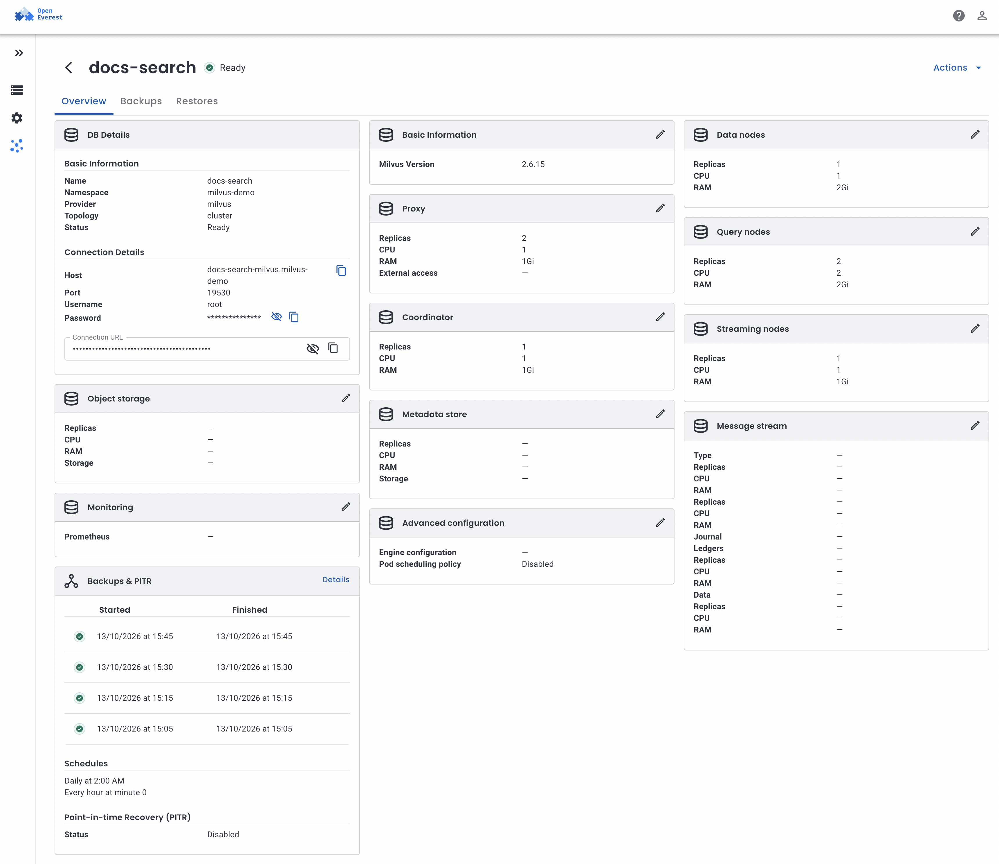
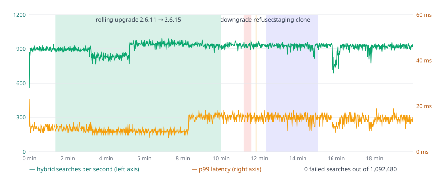
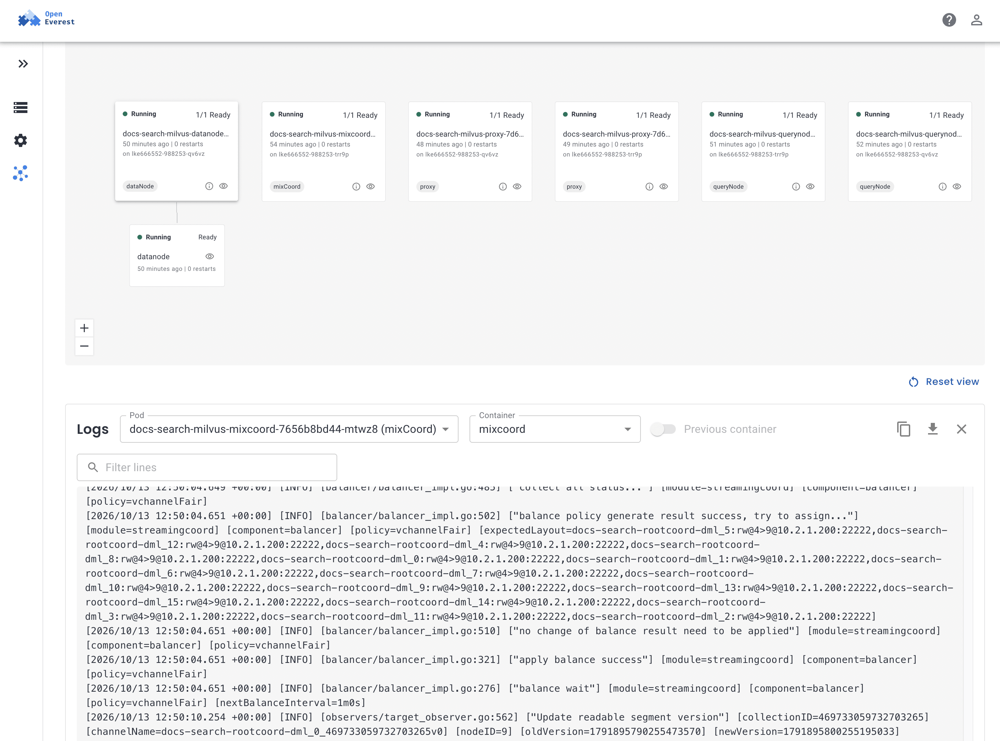
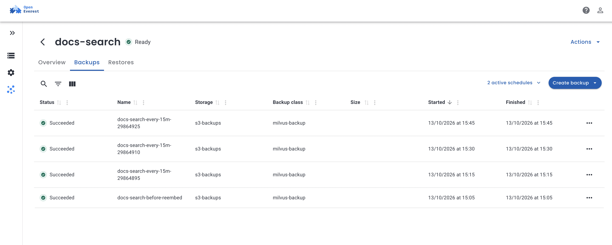

Sooner or later someone asks the platform team for a vector database. It starts with one RAG prototype, then a second team wants semantic search, and soon there are three different setups nobody wants to own.

[Milvus](https://milvus.io) is one of the most popular open-source answers. It is also a lot of moving parts: five kinds of Milvus processes, plus etcd for metadata, object storage for data, and a write-ahead log. That is great for scaling and not so great for the person on call.

As of [`provider-milvus` 0.2.0](https://github.com/openeverest/provider-milvus), Milvus is available on OpenEverest. You get the same `Instance` API and UI you use for PostgreSQL, MongoDB or Valkey, and the provider takes care of the rest. I wanted to see if it holds up for real platform work, so I did what a team would do with it:

1. Created a production-shaped Milvus cluster.
2. Indexed the entire English Kubernetes documentation for semantic and full-text search.
3. Upgraded Milvus while a client kept searching, and tried to downgrade it.
4. Took scheduled backups to S3 and cloned production into a staging instance from one of them.

Everything below ran on a real cluster. The numbers are what I measured, including the parts that didn't go well.

## How Milvus fits into OpenEverest

OpenEverest v2 is built around **providers**. The core knows nothing about Milvus. It stores an `Instance`, and the provider turns it into whatever the database needs. `provider-milvus` doesn't reimplement Milvus lifecycle management either. It drives the [Milvus Operator](https://github.com/zilliztech/milvus-operator), which the Milvus maintainers ship, and bundles it in the same Helm chart.

<div class="mvs-flow" role="img" aria-label="A user, API or the OpenEverest UI creates an Instance. provider-milvus reconciles it into a Milvus custom resource, which the Milvus Operator turns into Milvus components, etcd, and object storage. For backups and restores, provider-milvus runs milvus-backup Jobs that copy data to an S3 BackupStorage. Status and connection details flow back to the Instance.">
  <svg viewBox="0 0 920 300" xmlns="http://www.w3.org/2000/svg" width="100%" height="auto" font-family="ui-sans-serif, system-ui, -apple-system, Segoe UI, Roboto, sans-serif">
    <defs>
      <marker id="mvs-arrow" viewBox="0 0 10 10" refX="9" refY="5" markerWidth="7" markerHeight="7" orient="auto-start-reverse"><path d="M0 0 L10 5 L0 10 z" fill="#6b7280" /></marker>
    </defs>
    <rect x="16" y="80" rx="10" width="150" height="60" fill="#f3f4f6" stroke="#d1d5db" />
    <text x="91" y="106" text-anchor="middle" font-size="15" font-weight="600" fill="#111827">User / API / UI</text>
    <text x="91" y="125" text-anchor="middle" font-size="12" fill="#6b7280">creates</text>
    <rect x="216" y="70" rx="10" width="170" height="80" fill="#e8f7f0" stroke="#0aa66e" />
    <text x="301" y="100" text-anchor="middle" font-size="15" font-weight="700" fill="#0f172a">Instance</text>
    <text x="301" y="120" text-anchor="middle" font-size="11" fill="#4b5563">core.openeverest.io</text>
    <rect x="436" y="70" rx="10" width="170" height="80" fill="#f3f4f6" stroke="#d1d5db" />
    <text x="521" y="100" text-anchor="middle" font-size="15" font-weight="700" fill="#111827">provider-milvus</text>
    <text x="521" y="120" text-anchor="middle" font-size="11" fill="#6b7280">reconciles</text>
    <rect x="656" y="70" rx="10" width="170" height="80" fill="#f3f4f6" stroke="#d1d5db" />
    <text x="741" y="98" text-anchor="middle" font-size="15" font-weight="700" fill="#111827">Milvus CR</text>
    <text x="741" y="117" text-anchor="middle" font-size="11" fill="#6b7280">Milvus Operator</text>
    <rect x="626" y="176" rx="10" width="230" height="44" fill="#eef2ff" stroke="#c7d2fe" />
    <text x="741" y="195" text-anchor="middle" font-size="11" fill="#3730a3">proxy · mixCoord · dataNode</text>
    <text x="741" y="211" text-anchor="middle" font-size="11" fill="#3730a3">queryNode · streamingNode</text>
    <rect x="626" y="236" rx="10" width="230" height="34" fill="#eef2ff" stroke="#c7d2fe" />
    <text x="741" y="257" text-anchor="middle" font-size="11" fill="#3730a3">etcd · MinIO (data + Woodpecker WAL)</text>
    <rect x="406" y="196" rx="10" width="170" height="60" fill="#fff7ed" stroke="#fdba74" />
    <text x="491" y="221" text-anchor="middle" font-size="13" font-weight="700" fill="#7c2d12">milvus-backup Jobs</text>
    <text x="491" y="239" text-anchor="middle" font-size="11" fill="#9a3412">backup · restore · delete</text>
    <rect x="216" y="206" rx="10" width="140" height="40" fill="#fff7ed" stroke="#fdba74" />
    <text x="286" y="231" text-anchor="middle" font-size="12" font-weight="600" fill="#7c2d12">S3 BackupStorage</text>
    <line x1="166" y1="110" x2="212" y2="110" stroke="#6b7280" stroke-width="2" marker-end="url(#mvs-arrow)" />
    <line x1="386" y1="110" x2="432" y2="110" stroke="#6b7280" stroke-width="2" marker-end="url(#mvs-arrow)" />
    <line x1="606" y1="110" x2="652" y2="110" stroke="#6b7280" stroke-width="2" marker-end="url(#mvs-arrow)" />
    <line x1="741" y1="150" x2="741" y2="172" stroke="#6b7280" stroke-width="2" marker-end="url(#mvs-arrow)" />
    <line x1="521" y1="150" x2="499" y2="192" stroke="#fb923c" stroke-width="2" marker-end="url(#mvs-arrow)" />
    <line x1="576" y1="226" x2="622" y2="206" stroke="#fb923c" stroke-width="2" stroke-dasharray="4 3" marker-end="url(#mvs-arrow)" />
    <line x1="406" y1="226" x2="360" y2="226" stroke="#fb923c" stroke-width="2" marker-end="url(#mvs-arrow)" />
    <path d="M741 68 C741 40, 301 40, 301 66" fill="none" stroke="#0aa66e" stroke-width="2" stroke-dasharray="5 4" />
    <text x="521" y="34" text-anchor="middle" font-size="11" fill="#0aa66e">status · endpoints · credentials</text>
  </svg>
</div>

The provider watches `Instance` resources with `spec.providerRef.name: milvus` and reconciles them into a `Milvus` custom resource. The operator does the rest: it starts the Milvus processes, installs etcd and MinIO as bundled dependencies, and rolls upgrades. The provider adds what OpenEverest users expect from any database: generated credentials, a connection Secret, a downgrade guard, and backups.

Backups are the one place where the provider runs something itself. The Milvus Operator has no backup feature, so the provider runs [milvus-backup](https://github.com/zilliztech/milvus-backup), the Milvus project's own tool, as Kubernetes Jobs. It doesn't copy any data on its own.

## Pick a topology

Milvus comes in two shapes, and the provider supports both. Click through to see what each one runs.

<div class="mvs-tabs">
  <input type="radio" name="mvs-topo" id="mvs-topo-standalone" checked>
  <input type="radio" name="mvs-topo" id="mvs-topo-cluster">
  <div class="mvs-tabbar">
    <label for="mvs-topo-standalone" data-tab="standalone">Standalone</label>
    <label for="mvs-topo-cluster" data-tab="cluster">Cluster</label>
  </div>
  <div class="mvs-panel" data-panel="standalone">
    <div class="mvs-pods">
      <span class="mvs-pod mvs-milvus">standalone</span>
      <span class="mvs-pod mvs-dep">etcd</span>
      <span class="mvs-pod mvs-dep">MinIO</span>
    </div>
    <p>All of Milvus in one process, plus etcd for metadata and MinIO for data. 3 pods and 2 volumes. My staging copy below ran this way. Good for development, staging and small datasets.</p>
  </div>
  <div class="mvs-panel" data-panel="cluster">
    <div class="mvs-pods">
      <span class="mvs-pod mvs-milvus">proxy × 2</span>
      <span class="mvs-pod mvs-milvus">mixCoord</span>
      <span class="mvs-pod mvs-milvus">queryNode × 2</span>
      <span class="mvs-pod mvs-milvus">dataNode</span>
      <span class="mvs-pod mvs-milvus">streamingNode</span>
      <span class="mvs-pod mvs-dep">etcd × 3</span>
      <span class="mvs-pod mvs-dep">MinIO</span>
    </div>
    <p>Every Milvus role is its own Deployment and scales on its own: proxies take client traffic, query nodes serve searches, data nodes flush and compact, streaming nodes own the write-ahead log, and mixCoord coordinates. The WAL defaults to Woodpecker, which keeps it in object storage, so you don't need Pulsar or Kafka. Pulsar is still an option. This is the shape I used for "production": 11 pods and 4 volumes.</p>
  </div>
</div>

You can also point either topology at your own etcd and S3 bucket, including IAM-based access such as EKS IRSA. I used the bundled ones here.

## The setup

* Kubernetes 1.36 on Linode (LKE), 3 nodes with 8 vCPU and 16 GB each. The cluster also ran Valkey and PostgreSQL instances for other tests, so Milvus didn't have it to itself.
* OpenEverest v2.0.0-dev.4
* `provider-milvus` 0.2.0, which bundles the Milvus Operator 1.3.9
* Milvus 2.6.11 at first, upgraded to 2.6.15 later
* An S3 bucket on a separate MinIO in the cluster, used as the backup target

## Install the provider

The provider chart bundles the Milvus Operator, so one `helm install` is enough:

```bash
helm install provider-milvus \
  oci://ghcr.io/openeverest/charts/provider-milvus \
  --version 0.2.0 \
  --namespace everest-system
```

```bash
kubectl get providers milvus
```

## Create a Milvus cluster

In the UI, Milvus shows up as one more engine. The form is generated from the provider's own schema, so it only offers what the provider supports: topology and version first, then a section per Milvus role (replicas, CPU, RAM), then object storage, the metadata store and the message stream. Exposure, monitoring and pod scheduling sit under advanced configuration.

The UI creates an `Instance`. This is the one I used, with two proxies and two query nodes so a single pod restart doesn't take searches down:

```yaml
apiVersion: core.openeverest.io/v1alpha1
kind: Instance
metadata:
  name: docs-search
  namespace: milvus-demo
spec:
  providerRef:
    name: milvus
  version: "2.6.11"
  topology:
    type: cluster
  components:
    proxy:
      type: milvus
      replicas: 2
      resources:
        requests: {cpu: 250m, memory: 512Mi}
        limits: {cpu: "1", memory: 1Gi}
    mixCoord:
      type: milvus
      replicas: 1
    dataNode:
      type: milvus
      replicas: 1
    queryNode:
      type: milvus
      replicas: 2
      resources:
        requests: {cpu: 500m, memory: 1Gi}
        limits: {cpu: "2", memory: 2Gi}
    streamingNode:
      type: milvus
      replicas: 1
  backup:
    enabled: true
    classRef:
      name: milvus-backup
    storages:
      - storageRef:
          name: s3-backups
```

I trimmed the resources of the other roles; [`examples/instance-cluster.yaml`](https://github.com/openeverest/provider-milvus/blob/main/examples/instance-cluster.yaml) in the provider repo has a complete cluster manifest.

It was `Ready` **2 minutes 42 seconds** after `kubectl apply`, with 11 pods spread across the 3 nodes. Most of that time was etcd and MinIO starting and getting their volumes. Here is what one `Instance` turned into:

<div class="mvs-table">

| Resource | What `docs-search` got |
|---|---|
| Milvus pods | 7: 2 proxies, 2 query nodes, 1 each of mixCoord, dataNode, streamingNode |
| Dependencies | 3 etcd pods, 1 MinIO pod, 4 volumes of 10 GiB |
| Requests / limits | 2.65 CPU and 6 GiB requested, 9 CPU and 10 GiB limits |
| Service | `docs-search-milvus`, gRPC on 19530 |
| Secrets | `docs-search-conn` (connection details), `docs-search-credentials` (root password), `docs-search-minio` (generated MinIO keys) |

</div>

Authentication is on from the start, with a random root password. Applications read everything from the connection Secret: `host`, `port`, `username`, `password`, a ready-made `uri`, and a `token` in the `root:<password>` form pymilvus expects. The password never appears in the Milvus custom resource or in the config Milvus renders. To change it, you edit the credentials Secret and the provider rotates it in Milvus.



## Put something real in it: semantic search over the Kubernetes docs

A vector database without vectors proves little. Platform engineers have a corpus everybody knows: the Kubernetes documentation. So I indexed all of it.

* **Data:** every page under `content/en/docs` of [kubernetes/website](https://github.com/kubernetes/website) at commit `703e31c`: 1,721 pages, split by `##`/`###` headings into 15,582 chunks, 14 MiB of text.
* **Embeddings:** [`BAAI/bge-small-en-v1.5`](https://huggingface.co/BAAI/bge-small-en-v1.5) (384 dimensions) through [fastembed](https://github.com/qdrant/fastembed), on CPU, in a Kubernetes Job. No GPU anywhere.
* **Search:** an HNSW index on the embeddings, plus Milvus 2.6's built-in BM25 full-text search on the same text. Milvus computes the BM25 sparse vectors itself, so the client only sends the text.

This is the collection schema:

```python
schema = client.create_schema(auto_id=True)
schema.add_field("id", DataType.INT64, is_primary=True)
schema.add_field("title", DataType.VARCHAR, max_length=512)
schema.add_field("url", DataType.VARCHAR, max_length=512)
schema.add_field("text", DataType.VARCHAR, max_length=8192, enable_analyzer=True)
schema.add_field("dense", DataType.FLOAT_VECTOR, dim=384)
schema.add_field("sparse", DataType.SPARSE_FLOAT_VECTOR)
schema.add_function(Function(name="bm25", function_type=FunctionType.BM25,
                             input_field_names=["text"], output_field_names=["sparse"]))

index = client.prepare_index_params()
index.add_index(field_name="dense", index_type="HNSW", metric_type="COSINE",
                params={"M": 16, "efConstruction": 200})
index.add_index(field_name="sparse", index_type="SPARSE_INVERTED_INDEX", metric_type="BM25")
```

The client connects with the values from `docs-search-conn`, mounted as environment variables. Loading took 30 minutes, and Milvus was the fast part:

<div class="mvs-table">

| Step | Time |
|---|---|
| Embedding 15,582 chunks on 4 CPU cores | 29 min 22 s |
| Inserting them into Milvus, 64 rows per batch | 35 s |
| Flush and load into the query nodes | 1.7 s |

</div>

Then I asked it questions. Each one ran three ways: dense (vectors only), BM25 (keywords only) and hybrid (both, merged with reciprocal rank fusion in one `hybrid_search` call). Top 3 hits:

<div class="mvs-qa">
  <details open>
    <summary>"Limit how many pods of a deployment can be down during a voluntary disruption"</summary>
    <ol class="mvs-hits">
      <li><span>dense</span>Disruptions / Pod disruption budgets · Disruptions / Dealing with disruptions · Deployments / Updating a Deployment</li>
      <li><span>bm25</span>Specifying a Disruption Budget / Think about how your application reacts · Disruptions / Pod disruption budgets · Disruptions / Voluntary and involuntary disruptions</li>
      <li><span>hybrid</span>Disruptions / Pod disruption budgets · Specifying a Disruption Budget / Think about how your application reacts · Disruptions / Dealing with disruptions</li>
    </ol>
    <p>The question never says "PodDisruptionBudget", and every mode still finds it. This is the case semantic search is for.</p>
  </details>
  <details>
    <summary>"How do I drain a node before maintenance without breaking my app?"</summary>
    <ol class="mvs-hits">
      <li><span>dense</span>Upgrading kubeadm clusters / Drain the node · Upgrading Linux nodes / Drain the node · Upgrading Windows nodes / Drain the node</li>
      <li><span>bm25</span>Running ZooKeeper / Surviving maintenance · kubectl Quick Reference / Interacting with Nodes · Node lifecycle conditions</li>
      <li><span>hybrid</span>Upgrading kubeadm clusters / Drain the node · Running ZooKeeper / Surviving maintenance · kubectl Quick Reference / Interacting with Nodes</li>
    </ol>
    <p>The honest miss. The page you want, "Safely Drain a Node", isn't in anyone's top 3. The dense model latches onto "drain the node" sections in upgrade guides, and BM25 onto the word "maintenance". Search for "PodDisruptionBudget" and dense search puts that page second. This is about chunking and the model, not the database, but it's the work your application teams will do on top of what you give them.</p>
  </details>
  <details>
    <summary>"Why is my pod stuck in CrashLoopBackOff?"</summary>
    <ol class="mvs-hits">
      <li><span>dense</span>Pod Lifecycle / How Pods handle problems with containers · Specifying a Disruption Budget / Unhealthy Pod Eviction Policy · Pod Lifecycle / Pod phase</li>
      <li><span>bm25</span>Debug Pods / Debugging Pods · Jobs / Job tracking with finalizers · Windows debugging tips / Node-level troubleshooting</li>
      <li><span>hybrid</span>Pod Lifecycle / How Pods handle problems with containers · Debug Pods / Debugging Pods · Jobs / Job tracking with finalizers</li>
    </ol>
    <p>Dense gets the explanation, BM25 gets the debugging guide. Hybrid puts both in the top 2, which is why it's worth having both indexes in one collection.</p>
  </details>
  <details>
    <summary>"Run a pod only on nodes with a GPU"</summary>
    <ol class="mvs-hits">
      <li><span>dense</span>Schedule GPUs / Using device plugins · Schedule GPUs / Manage clusters with different types of GPUs · Running Pods on Only Some Nodes</li>
      <li><span>bm25</span>Schedule GPUs / Using device plugins · Schedule GPUs / Automatic node labelling · Schedule GPUs / Automatic node labelling</li>
      <li><span>hybrid</span>Schedule GPUs / Using device plugins · Schedule GPUs / Manage clusters with different types of GPUs · Schedule GPUs / Automatic node labelling</li>
    </ol>
  </details>
</div>

## Day 2, with traffic on

Creating a database is the easy part. I wanted to see what happens to the applications when the platform team does its job: upgrade, back up, clone.

So before touching anything, I started a probe: a Job with 4 threads running hybrid searches back to back, recording every result and its latency. On the untouched cluster it did about **900 searches per second, p50 4 ms, p99 10 ms**. It ran for 20 minutes, through everything below.

### Upgrading Milvus 2.6.11 → 2.6.15

In the UI you change the version on the instance. With `kubectl` it's one field:

```bash
kubectl -n milvus-demo patch instance docs-search --type merge \
  -p '{"spec":{"version":"2.6.15"}}'
```

The provider sees that every component uses the same image and switches the operator to a rolling upgrade. The operator then upgrades one role at a time, in the order Milvus requires. Click through the timeline:

<div class="mvs-steps">
  <input type="radio" name="mvs-step" id="mvs-s1" checked>
  <input type="radio" name="mvs-step" id="mvs-s2">
  <input type="radio" name="mvs-step" id="mvs-s3">
  <input type="radio" name="mvs-step" id="mvs-s4">
  <input type="radio" name="mvs-step" id="mvs-s5">
  <input type="radio" name="mvs-step" id="mvs-s6">
  <div class="mvs-stepbar">
    <label for="mvs-s1" data-step="1">0 s</label>
    <label for="mvs-s2" data-step="2">+65 s</label>
    <label for="mvs-s3" data-step="3">+2:05</label>
    <label for="mvs-s4" data-step="4">+4:05</label>
    <label for="mvs-s5" data-step="5">+5:05</label>
    <label for="mvs-s6" data-step="6">+8:38</label>
  </div>
  <div class="mvs-step" data-step="1">
    <div class="mvs-roles"><span class="mvs-new">mixCoord</span><span>streamingNode</span><span>queryNode × 2</span><span>dataNode</span><span>proxy × 2</span></div>
    <p class="mvs-client">Probe: ~900 searches/s, 0 errors</p>
    <p>The version changes on the <code>Instance</code>, and the instance goes to <code>Updating</code>. The coordinator goes first: a new mixCoord pod starts on 2.6.15, takes over, and the old one goes away.</p>
  </div>
  <div class="mvs-step" data-step="2">
    <div class="mvs-roles"><span class="mvs-done">mixCoord</span><span class="mvs-new">streamingNode</span><span>queryNode × 2</span><span>dataNode</span><span>proxy × 2</span></div>
    <p class="mvs-client">Probe: ~880 searches/s, 0 errors</p>
    <p>The streaming node, which owns the write-ahead log, is next. There is only one, so for a few seconds there were two, then one again.</p>
  </div>
  <div class="mvs-step" data-step="3">
    <div class="mvs-roles"><span class="mvs-done">mixCoord</span><span class="mvs-done">streamingNode</span><span class="mvs-new">queryNode × 2</span><span>dataNode</span><span>proxy × 2</span></div>
    <p class="mvs-client">Probe: <b>~830 searches/s</b> for 2 minutes, 0 errors</p>
    <p>Query nodes are upgraded blue/green: the operator starts a second query node group on 2.6.15, moves the loaded segments over, then scales the old group to zero. This is the only part the probe noticed. Throughput dipped by about 8% while the new group loaded the collection, and the slowest second still had 768 searches.</p>
  </div>
  <div class="mvs-step" data-step="4">
    <div class="mvs-roles"><span class="mvs-done">mixCoord</span><span class="mvs-done">streamingNode</span><span class="mvs-done">queryNode × 2</span><span class="mvs-new">dataNode</span><span>proxy × 2</span></div>
    <p class="mvs-client">Probe: ~950 searches/s, 0 errors</p>
    <p>The data node is upgraded. Searches don't touch it, so nothing to see.</p>
  </div>
  <div class="mvs-step" data-step="5">
    <div class="mvs-roles"><span class="mvs-done">mixCoord</span><span class="mvs-done">streamingNode</span><span class="mvs-done">queryNode × 2</span><span class="mvs-done">dataNode</span><span class="mvs-new">proxy × 2</span></div>
    <p class="mvs-client">Probe: ~940 searches/s, 0 errors</p>
    <p>Proxies go last, one at a time. The client was connected through the Service the whole time and didn't see a single failed call.</p>
  </div>
  <div class="mvs-step" data-step="6">
    <div class="mvs-roles"><span class="mvs-done">mixCoord</span><span class="mvs-done">streamingNode</span><span class="mvs-done">queryNode × 2</span><span class="mvs-done">dataNode</span><span class="mvs-done">proxy × 2</span></div>
    <p class="mvs-client">Probe: ~930 searches/s, 0 errors</p>
    <p>The last pod was running 2.6.15 about 6 minutes after the change. The <code>Instance</code> only said <code>Ready</code> at 8 minutes 38 seconds, when the operator reported the upgrade finished. Until then it stayed <code>Updating</code> and the connection details stayed published.</p>
  </div>
</div>



**Zero failed searches out of 468,420 during the upgrade**, and 1,092,480 over the whole 20 minutes. The slowest single search took 46 ms.

One thing I can't explain yet: about a minute after the proxies finished, p99 went from ~10 ms to ~15 ms and stayed there, while p50 stayed at 4 ms and throughput went *up* a bit. It could be a change in 2.6.15 or how segments landed on the new query nodes. I didn't dig into it for this post. The two dips around 16 and 18 minutes are mine: two short Jobs loading the embedding model on a shared node.

To see what happened inside, you don't need `kubectl`. The [Inspector plugin](https://github.com/openeverest/plugin-inspector) shows every pod behind the instance, which node it runs on and how often it restarted, and streams its logs. Here, after the upgrade: the Milvus pods spread across the nodes with 0 restarts, and the coordinator's log assigning the WAL channels to the streaming node.



### Trying to go back

Downgrades are where vector databases bite you: the newer version may already have written metadata the older one doesn't understand. So the provider refuses them:

```bash
kubectl -n milvus-demo patch instance docs-search --type merge \
  -p '{"spec":{"version":"2.6.11"}}'
```

Milvus didn't change: every pod stayed on 2.6.15, and the probe didn't notice. The provider log says exactly why:

```
component "dataNode" cannot be downgraded from 2.6.15 to 2.6.11; choose 2.6.15 or newer
```

The rough part is where you see it. The `Instance` went to `Failed`, but on OpenEverest v2.0.0-dev.4 the reason isn't copied to the `Instance` status. "Failed" with no message is scary when Milvus itself is fine. Setting the version back to 2.6.15 brought the `Instance` back to `Ready` within seconds.

### Backups to S3

OpenEverest describes backup targets with a `BackupStorage`. The provider reads it and hands its bucket and credentials to milvus-backup. Credentials are passed as Secret references, not written into any config:

```yaml
apiVersion: backup.openeverest.io/v1alpha1
kind: BackupStorage
metadata:
  name: s3-backups
  namespace: milvus-demo
spec:
  type: s3
  s3:
    bucket: milvus-backups
    region: us-east-1
    endpointURL: http://backup-minio.backup-storage.svc:9000
    credentialsSecretRef:
      name: s3-backups
---
apiVersion: backup.openeverest.io/v1alpha1
kind: Backup
metadata:
  name: docs-search-before-reembed
  namespace: milvus-demo
spec:
  origin:
    type: Instance
    instanceRef:
      name: docs-search
  classRef:
    name: milvus-backup
  storageRef:
    name: s3-backups
```

The backup was `Succeeded` in **5 seconds** and wrote **24 MB** under `everest/milvus/milvus-demo/docs-search/` in the bucket. The probe didn't notice it.

Schedules live on the instance. Each one becomes a CronJob, and every run shows up as a regular `Backup` that you can restore from or delete:

```yaml
spec:
  backup:
    storages:
      - storageRef:
          name: s3-backups
        schedules:
          - name: nightly
            enabled: true
            cron: "0 2 * * *"          # UTC
            retention: {type: count, count: 7}
          - name: every-15m
            enabled: true
            cron: "*/15 * * * *"
            retention: {type: time, duration: 1d}
```

The first `every-15m` run started at 12:15:00 and was done at 12:15:05. Retention deletes the old runs, and their data in the bucket with them.



The UI shows times in my local timezone (UTC+3), so 12:05 UTC is 15:05 here. The Size column is still empty; the provider doesn't report backup sizes yet.

### Cloning production into staging

This is the feature I'd show a team first. Staging that has the same data as production, created by the platform and not by a script someone wrote two years ago. A new `Instance` with a `dataSource` starts empty, restores the backup, and only then reports `Ready`. It doesn't have to match production's topology: staging here is a single standalone pod.

```yaml
apiVersion: core.openeverest.io/v1alpha1
kind: Instance
metadata:
  name: docs-search-staging
  namespace: milvus-demo
spec:
  providerRef:
    name: milvus
  topology:
    type: standalone
  components:
    standalone:
      type: milvus
      replicas: 1
  backup:
    enabled: true
    classRef:
      name: milvus-backup
    storages:
      - storageRef:
          name: s3-backups
  dataSource:
    type: Backup
    backup:
      backupRef:
        name: docs-search-before-reembed
```

<div class="mvs-table">

| Time | Staging |
|---|---|
| 12:06:16 | `Instance` created, phase `Restoring` |
| 12:08:23 | Milvus is up, the restore Job starts |
| 12:08:54 | Restore done: 15,582 rows, HNSW and BM25 indexes rebuilt |
| 12:08:59 | `Ready`, connection Secret published |

</div>

**2 minutes 43 seconds** from nothing to a searchable copy. The restore itself took 31 seconds; the rest was Milvus starting. While seeding, the instance reports `Restoring` and doesn't publish its connection details, so nothing connects to a half-restored database.

Is it really the same? I ran the six questions against both instances and compared the top 5 results by primary key. They matched exactly, and so did the row count.

## What's not there yet

<details class="mvs-card">
  <summary><span class="mvs-badge mvs-b-core">Core</span> Errors don't reach the Instance status</summary>
  <p>On OpenEverest v2.0.0-dev.4, when the provider rejects a change, like the downgrade above, the <code>Instance</code> says <code>Failed</code> with an empty message. The reason is only in the provider log. Core is adding a <code>Ready</code> condition with the reason <code>ValidationFailed</code> (<a href="https://github.com/openeverest/openeverest/pull/3351">openeverest#3351</a>); the part that fills it in is still in progress.</p>
</details>

<details class="mvs-card">
  <summary><span class="mvs-badge mvs-b-limit">Limit</span> Restores need Milvus 2.6.12 or newer</summary>
  <p>Older 2.6 releases corrupt data restored through bulk import (<a href="https://github.com/milvus-io/milvus/issues/48114">milvus-io/milvus#48114</a>), so the provider refuses restores into them. Backups work on every version. 2.6.15 is the default in 0.2.0.</p>
</details>

<details class="mvs-card">
  <summary><span class="mvs-badge mvs-b-limit">Limit</span> No point-in-time recovery, no global snapshot</summary>
  <p>milvus-backup takes full backups, collection by collection. Writes during a backup aren't paused, so each collection is consistent with itself but not with the others. For most vector workloads that's fine. If your collections must line up exactly, pause writes around the backup.</p>
</details>

<details class="mvs-card">
  <summary><span class="mvs-badge mvs-b-limit">Limit</span> S3-compatible backup storage only</summary>
  <p>AWS S3, MinIO, and other S3-compatible stores. GCS through its S3 interoperability should work, but I haven't tested it. Native GCS and Azure Blob need new <code>BackupStorage</code> types in OpenEverest core.</p>
</details>

<details class="mvs-card">
  <summary><span class="mvs-badge mvs-b-plan">Planned</span> No UI for the data</summary>
  <p>OpenEverest manages the database, not its collections. There's no way to browse collections or run a query from the OpenEverest UI. Bundling <a href="https://github.com/zilliztech/attu">Attu</a>, Milvus's web UI, is on the list (<a href="https://github.com/openeverest/provider-milvus/issues/52">#52</a>).</p>
</details>

<details class="mvs-card">
  <summary><span class="mvs-badge mvs-b-plan">Planned</span> Bundled dependencies are for getting started</summary>
  <p>The bundled MinIO runs as a single pod by default, and pod scheduling rules apply to Milvus pods only, not to etcd or MinIO. For production data, point the instance at your own S3 bucket. The provider supports that, including IAM-based access, and external etcd.</p>
</details>

## In 0.2.0, but not in this post

* **GPU builds.** A `2.6.15-gpu` version bundle runs every role on the GPU image.
* **Node pools per role.** Run one role, for example query nodes, as several groups with their own node selectors, such as one group on L40S nodes and one on H200.
* **Prometheus.** One toggle creates a `PodMonitor` for every Milvus component.
* **External access.** `LoadBalancer` or `NodePort` on the client-facing component, with the external address in the connection Secret.
* **Password rotation.** Change the password in the credentials Secret and the provider applies it in Milvus.

## Practical advice

If you're about to offer Milvus to your teams:

* **Start teams on standalone, move to cluster when they need it.** Standalone is 3 pods; the cluster above is 11.
* **Run at least two proxies and two query nodes in production.** That's the shape that kept the probe at zero errors through the upgrade. mixCoord and the streaming node ran one replica each here and were replaced without errors, but I didn't kill them by force.
* **Plan for the embedding pipeline, not the database.** Loading 15,582 chunks took 35 seconds in Milvus and 29 minutes in a CPU embedding model. Your teams' bottleneck is GPUs for embeddings, not vector storage.
* **Turn on scheduled backups from day one,** to real object storage, not the bundled MinIO.
* **Give teams staging copies from backups** instead of letting them load production data by hand. It took under 3 minutes here.

## Try It Yourself

* **Install:** Follow the [quick install guide](https://openeverest.io/documentation/2.0.0-dev.4/quick-install.html) to get OpenEverest v2 running in your cluster.
* **Milvus:** Go to the [provider-milvus](https://github.com/openeverest/provider-milvus) repository for the README, examples and the backup design.
* **Chat:** Join the conversation in the CNCF Slack (channel: [#openeverest-users](https://cloud-native.slack.com/archives/C09RRGZL2UX)).

If you try this and see something different, please open an issue in [provider-milvus](https://github.com/openeverest/provider-milvus/issues).

<div style="display:flex;gap:12px;margin:24px 0 40px;flex-wrap:wrap;">
  <a href="https://openeverest.io/documentation/2.0.0-dev.4/quick-install.html" target="_blank" rel="noopener noreferrer" style="display:inline-flex;align-items:center;gap:8px;background-color:#0aa66e;color:#fff;text-decoration:none;padding:10px 20px;border-radius:6px;font-weight:600;font-size:15px;">
    <svg xmlns="http://www.w3.org/2000/svg" width="20" height="20" viewBox="0 0 24 24" fill="none" stroke="#fff" stroke-width="2" stroke-linecap="round" stroke-linejoin="round"><path d="M4 19.5A2.5 2.5 0 0 1 6.5 17H20"/><path d="M6.5 2H20v20H6.5A2.5 2.5 0 0 1 4 19.5v-15A2.5 2.5 0 0 1 6.5 2z"/></svg>
    Try OpenEverest
  </a>
  <a href="https://cloud-native.slack.com/archives/C09RRGZL2UX" target="_blank" rel="noopener noreferrer" style="display:inline-flex;align-items:center;gap:8px;background-color:#4A154B;color:#fff;text-decoration:none;padding:10px 20px;border-radius:6px;font-weight:600;font-size:15px;">
    <svg xmlns="http://www.w3.org/2000/svg" width="20" height="20" viewBox="0 0 122.8 122.8"><path d="M25.8 77.6c0 7.1-5.8 12.9-12.9 12.9S0 84.7 0 77.6s5.8-12.9 12.9-12.9h12.9v12.9zm6.5 0c0-7.1 5.8-12.9 12.9-12.9s12.9 5.8 12.9 12.9v32.3c0 7.1-5.8 12.9-12.9 12.9s-12.9-5.8-12.9-12.9V77.6z" fill="#e01e5a"/><path d="M45.2 25.8c-7.1 0-12.9-5.8-12.9-12.9S38.1 0 45.2 0s12.9 5.8 12.9 12.9v12.9H45.2zm0 6.5c7.1 0 12.9 5.8 12.9 12.9s-5.8 12.9-12.9 12.9H12.9C5.8 58.1 0 52.3 0 45.2s5.8-12.9 12.9-12.9h32.3z" fill="#36c5f0"/><path d="M97 45.2c0-7.1 5.8-12.9 12.9-12.9s12.9 5.8 12.9 12.9-5.8 12.9-12.9 12.9H97V45.2zm-6.5 0c0 7.1-5.8 12.9-12.9 12.9s-12.9-5.8-12.9-12.9V12.9C64.7 5.8 70.5 0 77.6 0s12.9 5.8 12.9 12.9v32.3z" fill="#2eb67d"/><path d="M77.6 97c7.1 0 12.9 5.8 12.9 12.9s-5.8 12.9-12.9 12.9-12.9-5.8-12.9-12.9V97h12.9zm0-6.5c-7.1 0-12.9-5.8-12.9-12.9s5.8-12.9 12.9-12.9h32.3c7.1 0 12.9 5.8 12.9 12.9s-5.8 12.9-12.9 12.9H77.6z" fill="#ecb22e"/></svg>
    Join Slack
  </a>
  <a href="https://github.com/openeverest/provider-milvus" target="_blank" rel="noopener noreferrer" style="display:inline-flex;align-items:center;gap:8px;background-color:#24292f;color:#fff;text-decoration:none;padding:10px 20px;border-radius:6px;font-weight:600;font-size:15px;">
    <svg xmlns="http://www.w3.org/2000/svg" width="20" height="20" viewBox="0 0 16 16" fill="#fff"><path d="M8 .25a7.75 7.75 0 1 0 0 15.5A7.75 7.75 0 0 0 8 .25zm0 1.5a6.25 6.25 0 0 1 1.97 12.18c-.31.06-.42-.13-.42-.3v-1.05c0-.36-.01-1.02-.49-1.4 1.62-.18 2.5-.88 2.5-2.57 0-.57-.2-1.1-.53-1.49.05-.14.23-.7-.05-1.47 0 0-.44-.14-1.44.54a5.02 5.02 0 0 0-2.62 0C5.93 6.6 5.49 6.74 5.49 6.74c-.28.77-.1 1.33-.05 1.47-.33.39-.53.92-.53 1.49 0 1.69.88 2.39 2.5 2.57-.31.27-.43.67-.47 1.04-.42.19-1.5.52-2.16-.62 0 0-.39-.71-1.13-.76 0 0-.72-.01-.05.45 0 0 .48.23.82 1.08 0 0 .43 1.32 2.49.87v.75c0 .17-.11.36-.42.3A6.25 6.25 0 0 1 8 1.75z"/></svg>
    Star the Provider
  </a>
</div>

<style>
.mvs-flow{margin:1.5rem 0;padding:0.5rem 0;}
.mvs-tabs,.mvs-steps{margin:1.5rem 0;border:1px solid rgba(127,127,127,0.25);border-radius:12px;overflow:hidden;}
.mvs-tabs>input,.mvs-steps>input{position:absolute;opacity:0;pointer-events:none;}
.mvs-tabbar,.mvs-stepbar{display:flex;flex-wrap:wrap;border-bottom:1px solid rgba(127,127,127,0.25);background:rgba(127,127,127,0.06);}
.mvs-tabbar label,.mvs-stepbar label{flex:1;white-space:nowrap;text-align:center;padding:12px 8px;font-size:14px;font-weight:600;color:#6b7280;cursor:pointer;user-select:none;border-bottom:2px solid transparent;transition:color .15s,border-color .15s,background .15s;}
.mvs-tabbar label:hover,.mvs-stepbar label:hover{color:#0f172a;}
.mvs-panel,.mvs-step{display:none;padding:18px 22px;}
.mvs-panel p,.mvs-step p{margin:.5rem 0;}
#mvs-topo-standalone:checked~.mvs-tabbar label[data-tab="standalone"],
#mvs-topo-cluster:checked~.mvs-tabbar label[data-tab="cluster"]{color:#0aa66e;border-bottom-color:#0aa66e;background:#fff;}
#mvs-topo-standalone:checked~.mvs-panel[data-panel="standalone"],
#mvs-topo-cluster:checked~.mvs-panel[data-panel="cluster"]{display:block;}
#mvs-s1:checked~.mvs-stepbar label[data-step="1"],#mvs-s2:checked~.mvs-stepbar label[data-step="2"],
#mvs-s3:checked~.mvs-stepbar label[data-step="3"],#mvs-s4:checked~.mvs-stepbar label[data-step="4"],
#mvs-s5:checked~.mvs-stepbar label[data-step="5"],#mvs-s6:checked~.mvs-stepbar label[data-step="6"]{color:#0aa66e;border-bottom-color:#0aa66e;background:#fff;}
#mvs-s1:checked~.mvs-step[data-step="1"],#mvs-s2:checked~.mvs-step[data-step="2"],
#mvs-s3:checked~.mvs-step[data-step="3"],#mvs-s4:checked~.mvs-step[data-step="4"],
#mvs-s5:checked~.mvs-step[data-step="5"],#mvs-s6:checked~.mvs-step[data-step="6"]{display:block;}
.mvs-pods,.mvs-roles{display:flex;flex-wrap:wrap;gap:8px;margin:6px 0 12px;}
.mvs-pod,.mvs-roles span{display:inline-flex;align-items:center;padding:8px 12px;border:2px solid;border-radius:8px;font-size:14px;font-weight:600;}
.mvs-milvus{border-color:#1a8cff;background:#e8f2ff;color:#0b4f99;}
.mvs-dep{border-color:#9ca3af;background:#f3f4f6;color:#374151;}
.mvs-roles span{border-color:#d1d5db;background:#f9fafb;color:#6b7280;}
.mvs-roles span.mvs-new{border-color:#f59e0b;background:#fff4e0;color:#92400e;background-image:repeating-linear-gradient(45deg,rgba(255,255,255,0) 0 8px,rgba(255,255,255,.75) 8px 16px);}
.mvs-roles span.mvs-done{border-color:#0aa66e;background:#e8f7f0;color:#065f46;}
.mvs-client{font-size:14px;padding:8px 12px;border-radius:8px;background:#eef2ff;color:#312e81;}
.mvs-img{display:block;width:100%;height:auto;margin:1.5rem 0;border:1px solid rgba(127,127,127,0.25);border-radius:12px;padding:8px;background:#fff;}
.mvs-table{margin:1.5rem 0;overflow-x:auto;border:1px solid rgba(127,127,127,0.25);border-radius:12px;}
.mvs-table table{width:100%;border-collapse:collapse;font-size:14px;margin:0;}
.mvs-table th,.mvs-table td{padding:10px 16px;text-align:left;vertical-align:top;line-height:1.5;border-bottom:1px solid rgba(127,127,127,0.18);}
.mvs-table tr:last-child td{border-bottom:0;}
.mvs-table th{background:rgba(127,127,127,0.06);font-weight:600;}
.mvs-table td:first-child{white-space:nowrap;font-weight:600;color:#374151;}
.mvs-qa details{margin:10px 0;border:1px solid rgba(127,127,127,0.25);border-radius:10px;padding:10px 14px;}
.mvs-qa summary{cursor:pointer;font-weight:600;}
.mvs-hits{list-style:none;padding:0;margin:10px 0;}
.mvs-hits li{font-size:14px;margin:6px 0;line-height:1.5;}
.mvs-hits li span{display:inline-block;min-width:64px;margin-right:8px;padding:1px 8px;border-radius:6px;background:#eef2ff;color:#312e81;font-size:12px;font-weight:700;text-align:center;}
.mvs-card{margin:10px 0;border:1px solid rgba(127,127,127,0.25);border-radius:10px;padding:10px 14px;}
.mvs-card>summary{cursor:pointer;font-weight:600;}
.mvs-badge{display:inline-block;margin-right:8px;padding:1px 8px;border-radius:6px;font-size:12px;font-weight:700;}
.mvs-b-core{background:#fee2e2;color:#991b1b;}
.mvs-b-limit{background:#fff4e0;color:#92400e;}
.mvs-b-plan{background:#e8f2ff;color:#0b4f99;}
</style>
