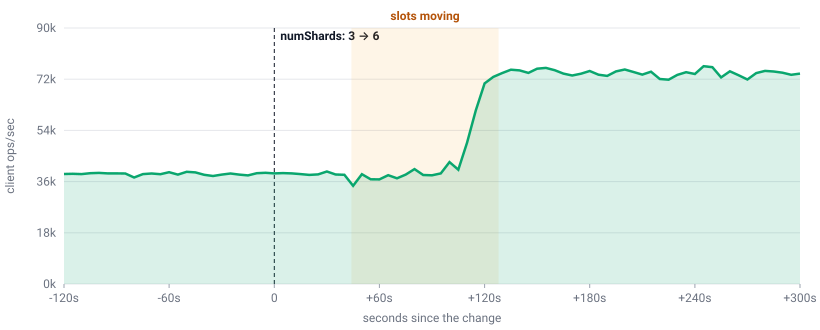
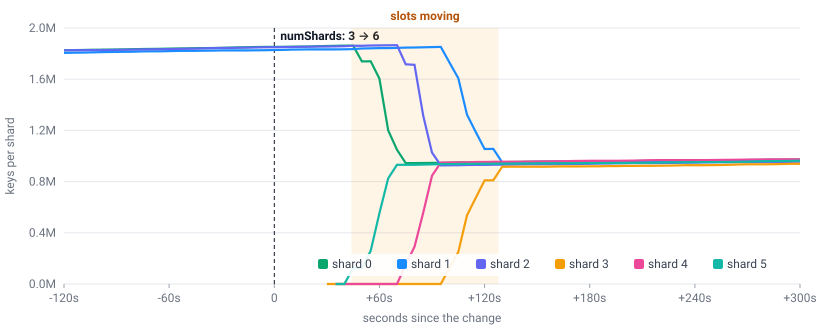
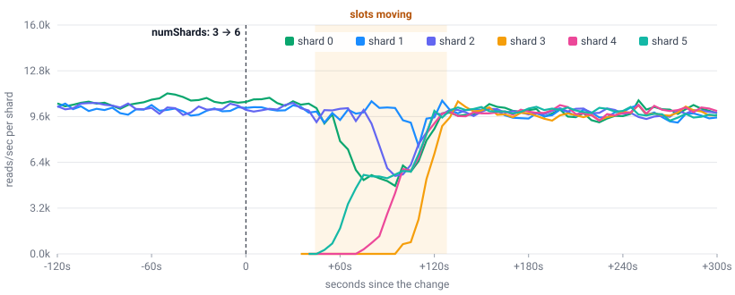
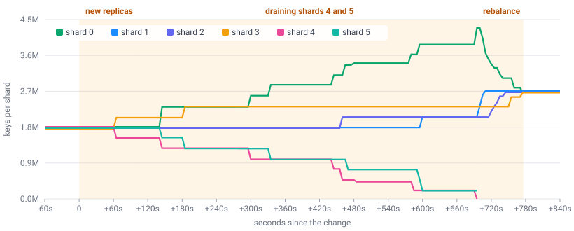
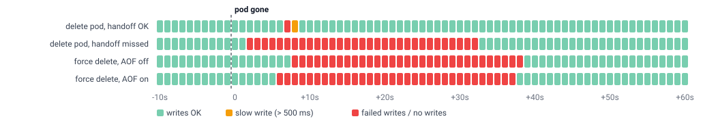

Scaling a sharded database is easy to promise and hard to do. You can add a shard in one line of YAML. The data still has to move, and clients still have to find it while it moves.

[`provider-valkey`](https://github.com/openeverest/provider-valkey) runs Valkey Cluster on OpenEverest through the [Valkey operator](https://github.com/valkey-io/valkey-operator). The operator can change the number of shards on a live cluster. I wanted to know what this looks like from the client side: does throughput actually grow, do clients get errors, and can you lose data. I also wanted to see how it behaves when things go wrong in the middle, because they do.

So I built a cluster that was already maxed out, and started changing it.

## The setup

* Kubernetes 1.36 cluster
* 4 dedicated nodes for Valkey (16 vCPU, 32 GB each) and 1 node for monitoring and test clients
* OpenEverest v2.0.0-dev.4
* `provider-valkey` 0.1.8 with valkey-operator 0.7.1
* Valkey 9.0.6, cluster topology, 3 shards with 1 replica each, TLS on
* kube-prometheus-stack and the OpenEverest metrics plugin for dashboards

This is where everything ran once the cluster had 6 shards. Each shard is a primary and a replica, and the operator never puts two pods of the same shard on one node. The dashed shards are the ones the scale-out added.

<div class="vks-topo">
  <div class="vks-pool">
    <div class="vks-pool-title">Valkey nodes <span>4 × 16 vCPU, 32 GB</span></div>
    <div class="vks-nodes">
      <div class="vks-node">
        <b>node 1</b>
        <span class="vks-pod vks-c0">shard 0</span>
        <span class="vks-pod vks-c1">shard 1</span>
        <span class="vks-pod vks-c4 vks-new">shard 4</span>
        <span class="vks-pod vks-tool">memtier</span>
      </div>
      <div class="vks-node">
        <b>node 2</b>
        <span class="vks-pod vks-c1">shard 1</span>
        <span class="vks-pod vks-c2">shard 2</span>
        <span class="vks-pod vks-c3 vks-new">shard 3</span>
        <span class="vks-pod vks-tool">memtier</span>
      </div>
      <div class="vks-node">
        <b>node 3</b>
        <span class="vks-pod vks-c0">shard 0</span>
        <span class="vks-pod vks-c3 vks-new">shard 3</span>
        <span class="vks-pod vks-c5 vks-new">shard 5</span>
        <span class="vks-pod vks-tool">memtier</span>
      </div>
      <div class="vks-node">
        <b>node 4</b>
        <span class="vks-pod vks-c2">shard 2</span>
        <span class="vks-pod vks-c4 vks-new">shard 4</span>
        <span class="vks-pod vks-c5 vks-new">shard 5</span>
        <span class="vks-pod vks-tool">memtier</span>
      </div>
    </div>
  </div>
  <div class="vks-pool vks-pool-tools">
    <div class="vks-pool-title">Tools node <span>8 vCPU, 16 GB</span></div>
    <div class="vks-nodes">
      <div class="vks-node">
        <span class="vks-pod vks-tool">write probe</span>
        <span class="vks-pod vks-tool">Prometheus</span>
        <span class="vks-pod vks-tool">Grafana</span>
      </div>
    </div>
  </div>
  <div class="vks-topo-notes">
    <span><i class="vks-pod vks-c0"></i>Valkey pod: 2 CPU, 4 GiB, 10 GiB volume</span>
    <span><i class="vks-pod vks-c3 vks-new"></i>added by the 3 → 6 scale-out</span>
    <span><i class="vks-pod vks-tool"></i>test client or monitoring (memtier: 3 CPU each)</span>
  </div>
</div>

Every client talks to every shard, so each memtier pod sends traffic to all four nodes, not just its own. Which pod of a shard is the primary changed during the tests, because every failover swaps the roles.

This is the `Instance`. It is what you get from the UI, plus a node selector and two config lines:

```yaml
apiVersion: core.openeverest.io/v1alpha1
kind: Instance
metadata:
  name: vk-shards
  namespace: valkey-blog
spec:
  providerRef:
    name: valkey
  version: "9.0"
  topology:
    type: cluster
    parameters:
      numShards: 3
  components:
    engine:
      type: valkey
      replicas: 1
      resources:
        limits:
          cpu: "2"
          memory: 4Gi
      storage:
        size: 10Gi
        storageClass: linode-block-storage
      parameters:
        config:
          maxmemory: 3gb
          maxmemory-policy: noeviction
    monitoring:
      type: exporter
```

To scale, I changed one number:

```bash
kubectl patch instance vk-shards -n valkey-blog --type merge \
  -p '{"spec":{"topology":{"parameters":{"numShards":6}}}}'
```

You can't change the number of shards in the UI yet. It is a known gap, more on it below.

## How I tested

I needed two clients: one to put real pressure on the cluster, and one to tell me exactly which writes failed and whether anything got lost.

**Load.** Four [memtier_benchmark](https://github.com/RedisLabs/memtier_benchmark) pods in cluster mode, one per Valkey node. Each runs 3 threads with 25 connections, 1 SET for every 4 GETs, 1 KB values over 2 million keys. Before the tests I preloaded all 2 million keys. memtier exposes Prometheus metrics, so throughput, errors and latency end up on the same dashboards as Valkey.

**Probe.** A small Python script with `redis-py`'s cluster client. Eight processes write sequential keys like `probe:{3:5124}:5124017`. The `{3:5124}` part is a hash tag, so every 1,000 consecutive keys land in the same hash slot. Every write is either acknowledged or recorded as failed. At the end I read back every acknowledged key. If an acknowledged key is missing, the cluster lost it. The hash tag also tells me the slot, and the slot tells me which shard lost it.

**Monitoring.** A loop that recorded the `ValkeyCluster` status every few seconds, and Prometheus scraping every 5 seconds.

The important detail: **the cluster was already saturated before every test.** With 3 shards, each primary's main thread was pinned at one CPU core. Valkey runs commands on a single thread, so one core per primary is the ceiling. The cluster did about 39,000 ops/sec with p99 latency around 48 ms. If adding shards works, throughput should go up. If it doesn't, nothing else matters.

That is the worst case, not a normal day. So at the end I repeated both scaling directions at about 45% of capacity, which is closer to how a production cluster should run.

## Scaling out: 3 to 6 shards

I changed `numShards` from 3 to 6 and watched. The whole thing took **126 seconds**, and throughput almost doubled.

<div class="vks-tabs">
  <input type="radio" name="vks-hero" id="vks-hero-ops" checked>
  <input type="radio" name="vks-hero" id="vks-hero-keys">
  <input type="radio" name="vks-hero" id="vks-hero-reads">
  <div class="vks-tabbar">
    <label for="vks-hero-ops" data-tab="ops">Client throughput</label>
    <label for="vks-hero-keys" data-tab="keys">Keys per shard</label>
    <label for="vks-hero-reads" data-tab="reads">Reads per shard</label>
  </div>
  <div class="vks-panel" data-panel="ops">
    
    <p>memtier ops/sec. Flat at ~39k while the new pods start, then ~75k once the slots have moved. p99 latency stayed at ~48 ms the whole time: the cluster is still saturated, there are just twice as many cores doing the work.</p>
  </div>
  <div class="vks-panel" data-panel="keys">
    
    <p>Each old shard gives half of its keys to one new shard, one pair at a time: shard 0 to shard 5, then 2 to 4, then 1 to 3. About 900k keys per pair, moved in roughly 25 seconds while the cluster served full traffic.</p>
  </div>
  <div class="vks-panel" data-panel="reads">
    
    <p>Reads per shard, from the Valkey exporter. About 10k reads/sec per shard before and after. Each shard was already doing all it could, so the only way to get more is more shards.</p>
  </div>
</div>

### What happens inside

Valkey Cluster splits the key space into 16,384 hash slots. Every key belongs to one slot, and every slot belongs to one shard. Scaling out means creating new shards and moving slots to them, together with the keys.

Valkey 9.0 brought a big change here: [atomic slot migration](https://valkey.io/blog/atomic-slot-migration/). Before 9.0, moving a slot meant moving its keys one by one with `MIGRATE`. While a slot was half-moved, clients got `ASK` redirects and multi-key commands could fail. Now the operator sends one `CLUSTER MIGRATESLOTS` command to the source. The source sends a snapshot of the slots to the target, streams the changes that happen in the meantime, pauses writes for a moment and hands over ownership in one step. It works a lot like replication. Clients don't see the slot until it has moved, and then get one `MOVED` for it. The operator moves up to 400 slots per batch, one batch per reconcile.

Click through the timeline:

<div class="vks-steps">
  <input type="radio" name="vks-step" id="vks-s1" checked>
  <input type="radio" name="vks-step" id="vks-s2">
  <input type="radio" name="vks-step" id="vks-s3">
  <input type="radio" name="vks-step" id="vks-s4">
  <input type="radio" name="vks-step" id="vks-s5">
  <input type="radio" name="vks-step" id="vks-s6">
  <div class="vks-stepbar">
    <label for="vks-s1" data-step="1">0 s</label>
    <label for="vks-s2" data-step="2">+8 s</label>
    <label for="vks-s3" data-step="3">+44 s</label>
    <label for="vks-s4" data-step="4">+74 s</label>
    <label for="vks-s5" data-step="5">+98 s</label>
    <label for="vks-s6" data-step="6">+128 s</label>
  </div>

  <div class="vks-step" data-step="1">
    <div class="vks-slots"><span class="vks-c0" style="flex:3">shard 0</span><span class="vks-c1" style="flex:3">shard 1</span><span class="vks-c2" style="flex:3">shard 2</span></div>
    <div class="vks-axis"><span>slot 0</span><span>16383</span></div>
    <p class="vks-client">Clients: <b>~39k ops/sec</b>, every primary at 1 core</p>
    <p>I set <code>numShards: 6</code>. OpenEverest passes it to the <code>ValkeyCluster</code>, and the operator creates <code>ValkeyNode</code> resources for shards 3, 4 and 5, a primary and a replica each.</p>
  </div>

  <div class="vks-step" data-step="2">
    <div class="vks-slots"><span class="vks-c0" style="flex:3">shard 0</span><span class="vks-c1" style="flex:3">shard 1</span><span class="vks-c2" style="flex:3">shard 2</span></div>
    <div class="vks-axis"><span>slot 0</span><span>16383</span></div>
    <div class="vks-pending"><span class="vks-c3">shard 3: starting</span><span class="vks-c4">shard 4: starting</span><span class="vks-c5">shard 5: starting</span></div>
    <p class="vks-client">Clients: <b>~39k ops/sec</b>, nothing changed yet</p>
    <p>Six new pods wait for their volumes. For about 10 seconds the cluster status says <code>Degraded: PodUnschedulable ... unbound immediate PersistentVolumeClaims</code>. It looks scary, but it's only the cloud volumes being created. Then the pods start and join the cluster without slots.</p>
  </div>

  <div class="vks-step" data-step="3">
    <div class="vks-slots"><span class="vks-c5 vks-moving" style="flex:1.5">5 ←</span><span class="vks-c0" style="flex:1.5">shard 0</span><span class="vks-c1" style="flex:3">shard 1</span><span class="vks-c2" style="flex:3">shard 2</span></div>
    <div class="vks-axis"><span>slot 0</span><span>16383</span></div>
    <p class="vks-client">Clients: <b>~37k ops/sec</b>, memtier gets <b class="vks-bad">5,060 × CLUSTERDOWN</b> in 10 seconds. The probe: 0 errors</p>
    <p>The operator starts moving the lower half of shard 0's slots to shard 5, 400 slots at a time. For about 10 seconds, the new primary of shard 5 answers some commands with <code>-CLUSTERDOWN The cluster is down</code>. Only the first new shard did this, and it happened in every scale-out I did. The probe didn't notice because <code>redis-py</code> retries <code>ClusterDownError</code> on its own.</p>
  </div>

  <div class="vks-step" data-step="4">
    <div class="vks-slots"><span class="vks-c5" style="flex:1.5">5</span><span class="vks-c0" style="flex:1.5">0</span><span class="vks-c1" style="flex:3">shard 1</span><span class="vks-c4 vks-moving" style="flex:1.5">4 ←</span><span class="vks-c2" style="flex:1.5">2</span></div>
    <div class="vks-axis"><span>slot 0</span><span>16383</span></div>
    <p class="vks-client">Clients: <b>~38k ops/sec</b>, no errors. Still flat</p>
    <p>Shard 5 is done. Before the next move, the operator waits until the new shard's replica has synced (<code>Waiting for replica sync</code>). That's the right call: a primary with fresh data and no synced replica is one crash away from losing it. Then shard 2 hands half of its slots to shard 4.</p>
    <p>Why is throughput still flat? Every memtier connection sends a request and waits for the answer, and keys are spread evenly. Shards 1 and 2 still own a third of all keys each and are still at 100% CPU. The cluster is as fast as its busiest shard.</p>
  </div>

  <div class="vks-step" data-step="5">
    <div class="vks-slots"><span class="vks-c5" style="flex:1.5">5</span><span class="vks-c0" style="flex:1.5">0</span><span class="vks-c3 vks-moving" style="flex:1.5">3 ←</span><span class="vks-c1" style="flex:1.5">1</span><span class="vks-c4" style="flex:1.5">4</span><span class="vks-c2" style="flex:1.5">2</span></div>
    <div class="vks-axis"><span>slot 0</span><span>16383</span></div>
    <p class="vks-client">Clients: <b>~40k ops/sec</b>, then a jump to 70k in 20 seconds</p>
    <p>The last pair: shard 1 to shard 3. Only when this move is done, no shard owns more than a sixth of the slots, and throughput jumps.</p>
  </div>

  <div class="vks-step" data-step="6">
    <div class="vks-slots"><span class="vks-c5" style="flex:1">5</span><span class="vks-c0" style="flex:1">0</span><span class="vks-c3" style="flex:1">3</span><span class="vks-c1" style="flex:1">1</span><span class="vks-c4" style="flex:1">4</span><span class="vks-c2" style="flex:1">2</span></div>
    <div class="vks-axis"><span>slot 0</span><span>16383</span></div>
    <p class="vks-client">Clients: <b class="vks-good">~75k ops/sec</b>, same p99, six primaries at 1 core each</p>
    <p>The cluster is <code>Ready</code>, 126 seconds after the change. 2,730 slots per shard, about 950k keys each. During the whole run OpenEverest showed the instance as <code>Provisioning</code>, even though it served traffic all the time.</p>
  </div>
</div>

To me this is the best part of the whole exercise. One number in the spec, two minutes, and twice the throughput, with zero lost writes and no client-visible errors except the `CLUSTERDOWN` burst. I don't have an explanation for that burst yet, but a client that retries doesn't see it.

## Scaling in

Scaling in is the same in reverse: move slots off the shards you remove, then delete them. I did it twice. 6 → 3 with lighter load took 313 seconds without a single error.

The second time I made it harder: *6 → 4 shards and 1 → 2 replicas per shard in the same change*, at full load. It took *776 seconds*, and again *0 failed writes*. The operator first added the new replicas, then drained shards 4 and 5, then rebalanced. But look at where the keys went:



Most of the drained slots went to *shard 0*. It peaked at 4.3 million keys, 1.6 times its final size, and only then the operator spread them out. The 6 → 3 run looked the same: shard 0 peaked at 1.7 times its final size. That's [how the drain is written](https://github.com/valkey-io/valkey-operator/blob/main/internal/valkey/cluster_rebalance.go) right now. It picks "the first valid destination" and leaves the rest to the rebalance at the end. The comment calls this intentionally simple.

It has two effects. A lot of data moves twice. And shard 0 becomes the hot shard: it owns a big share of slots, but it still has one core. Remember, the cluster is as fast as its busiest shard. Throughput went down from 73k to about 33k ops/sec during the drain and came back to 50k at the end (4 shards × 1 core). The scary part is memory. My shards used about 0.8 GB of 3 GB, so there was plenty of room. If your shards are 60% full and you scale in, the receiving shard can hit `maxmemory`, and with `noeviction` that means failed writes. With an eviction policy it is worse: Valkey silently drops keys.

Is 776 seconds a lot? Yes. The Valkey team [measured](https://valkey.io/blog/atomic-slot-migration/) a 4 → 3 scale-in of a 40 GB cluster under heavy load in 27 seconds. That's roughly 370 MB/s. My drain moved about 1.6 GB, counting the second move off shard 0, in about 670 seconds. That's 2 to 3 MB/s. It isn't a fair fight: my primaries had no CPU left, and migration has to share that one thread with clients. The operator also adds pauses: 400 slots per batch, one batch per reconcile, and a replica sync check in between. But a gap this big means most of the time is spent outside Valkey.

### And at a normal load?

Nobody should run a production cluster at 100% CPU. So I lowered memtier's request rate to about 45% of capacity. p99 latency dropped to 7 ms. Then I scaled out 4 → 6 and back to 4.

One detail if you try this: in cluster mode, memtier's `--rate-limiting` applies to every connection to every shard. The offered load grows and shrinks with the number of shards, so for these runs I compare latency, not throughput.

<div class="vks-table">

| | Saturated | ~45% load |
|---|---|---|
| Scale out | 3 → 6: **126 s** | 4 → 6: **118 s** |
| Scale in | 6 → 4, plus replicas 1 → 2: **776 s** | 6 → 4: **129 s** |
| Failed probe writes | 0 and 0 | 3 (`CLUSTERDOWN`) and 0 |
| p99 before → worst during | 48 → 63 ms, 45 → 50 ms | 8 → 43 ms, 6 → 36 ms |
| Shard 0 peak during scale-in | 1.6× final size | 1.5× final size |

</div>

Scale-out takes about two minutes either way. Most of that is creating pods and volumes, and the operator waiting between moves. Scale-in is six times faster with CPU to spare, even after you subtract the replica change from the saturated run. Clients see the change as a latency bump into the tens of milliseconds for a minute or two. They don't see errors.

The hot shard didn't go away: shard 0 still peaked at 1.5 times its final size. That comes from the drain logic, not from the load.

## Draining a node

Kubernetes upgrades and node maintenance mean `kubectl drain`. I drained a node with two primaries and one replica on it:

```bash
kubectl drain lke665663-986688-kd8pd --ignore-daemonsets --delete-emptydir-data
```

The operator creates a PodDisruptionBudget with `maxUnavailable: 1`, so the drain evicts one Valkey pod at a time and retries the rest with "Cannot evict pod as it would violate the pod's disruption budget". Each evicted primary handed its role to its replica on shutdown. Each pod then started on another node, after its block volume detached and attached there (about 30 to 45 seconds per pod).

The drain took *114 seconds*. The probe recorded *0 failed writes*, with the slowest write at 1.25 seconds. memtier dipped to 48k ops/sec for a moment. That's what a drain should look like.

## Killing primaries

Planned operations went well. Now the unplanned part. I deleted primary pods in two ways:

* **Graceful:** `kubectl delete pod`. The provider sets `shutdown-on-sigterm failover`, so on `SIGTERM` the primary hands its slots to its replica before it exits.
* **Force:** `kubectl delete pod --grace-period=0 --force`. The process is killed without warning, like an OOM kill or a crash.

Every row is one second, from the probe's point of view:



**Graceful delete works, mostly.** In 4 runs out of 5 the replica took over in about 0.7 seconds. The probe lost 0 to 2 writes, and memtier dipped to ~62k for a second. In one run the handoff didn't happen. The replica stayed a replica, the pod restarted, and the old primary got its slots back. That was 31 seconds of failed writes for one shard. I didn't capture the primary's log for that run, so I don't know why yet.

**Force delete is a different story.** I expected a failover. There wasn't one, and the reason is timing:

1. The pod is killed, and Kubernetes starts a new one right away. Valkey is up again in about 2 seconds.
2. Valkey declares a node failed only after `cluster-node-timeout`, which is 15 seconds. The restarted node is back long before that. Nobody fails over.
3. The restarted node still has its `nodes.conf`, so it rejoins as *primary*, with whatever data it loaded from disk.
4. The replica, which has the latest data, sees a primary with a different history and does a *full resync*. It throws away its data and copies the primary's.

Step 4 is where data gets lost. Without [AOF (Append Only File)](https://valkey.io/topics/persistence/), the restarted primary loads its last RDB snapshot. Everything written since that snapshot is gone, including what the replica had. My probe confirmed it: out of *8,730,666 acknowledged writes, 3,450 were missing*, all in slots of the shard I killed. One worker lost exactly one block, `probe:{0:533}:533102` to `533999`, slot 12303, owned by shard 5.

3,450 out of 8.7 million sounds like nothing. It is better to look at it as time: it was every write that shard took in the roughly 30 seconds since its last snapshot. With the default `save` rules, under enough writes, that window can be up to a minute. Valkey replication is asynchronous, and the docs say clearly that a cluster can lose acknowledged writes. The replication docs even have a section about this exact trap: a primary without full persistence that restarts automatically wipes its replicas.

Then I enabled AOF with `appendfsync everysec` through the `Instance` config and repeated the kill. Same sequence: the pod came back as primary in 2 seconds, and the replica did a full resync. But this time the primary loaded its AOF, and the final check found *1,984,672 acknowledged writes, 0 missing.* With `everysec`, Valkey writes the AOF to the file before it replies to the client, and only the `fsync` is delayed. A killed process doesn't lose what is already in the kernel page cache. A crashed node can still lose up to one second of writes. That is one kill, so it shows how it works, not a statistic.

### Why 30 seconds?

The force-killed pod was back in 2 seconds, but its slots failed for 30. I suspected DNS and tested it: I force-deleted another primary and resolved its hostname twice a second from a client pod.

```
-0.4s 10.2.1.15      # old pod IP
+30.5s 10.2.1.23     # new pod IP, the pod was Ready at +6s
```

For 30 seconds after the kill, DNS kept returning the *old* pod IP. With TLS, the operator announces nodes by hostname (`preferredEndpointType: Hostname`), so clients connect by name. CoreDNS on LKE has `ttl 30` and `cache 30`, which is also the default in most clusters. So clients spend 30 seconds trying to reach a pod that no longer exists. With a graceful delete this doesn't matter: the replica takes over, and the slots move to a host that is already in DNS.

One more thing for client authors: memtier got stuck. After both force kills it went to 0 ops/sec and never recovered, even with `--reconnect-on-error`. I had to restart it. The `redis-py` probe recovered by itself in both cases. Before you trust your client to survive a failover, test it.

## All runs in one place

Seconds in which the probe saw failed writes. Tap or click a row for details.

<div class="vks-chart">
  <details class="vks-row">
    <summary><span class="vks-label">Scale out 3 → 6 shards</span><span class="vks-track"><span class="vks-bar vks-ok" style="width:0.8%"></span></span><span class="vks-val">0 s</span></summary>
    <p class="vks-note">126 seconds, throughput 39k → 75k ops/sec. The probe saw nothing. memtier got 5,060 <code>CLUSTERDOWN</code> errors from the first new shard over 10 seconds.</p>
  </details>
  <details class="vks-row">
    <summary><span class="vks-label">Scale in 6 → 3 shards</span><span class="vks-track"><span class="vks-bar vks-ok" style="width:0.8%"></span></span><span class="vks-val">0 s</span></summary>
    <p class="vks-note">313 seconds with lighter load. No errors at all.</p>
  </details>
  <details class="vks-row">
    <summary><span class="vks-label">Scale in 6 → 4 and replicas 1 → 2</span><span class="vks-track"><span class="vks-bar vks-ok" style="width:0.8%"></span></span><span class="vks-val">0 s</span></summary>
    <p class="vks-note">776 seconds at full load. No errors, but throughput fell to ~33k ops/sec while shard 0 took most of the drained slots.</p>
  </details>
  <details class="vks-row">
    <summary><span class="vks-label">Scale out 4 → 6 at ~45% load</span><span class="vks-track"><span class="vks-bar vks-plan" style="width:6%"></span></span><span class="vks-val">3 s</span></summary>
    <p class="vks-note">118 seconds. One <code>CLUSTERDOWN</code> per second for 3 seconds when the first new shard got its slots, 3 failed writes in total. p99 went from 8 to 43 ms at worst.</p>
  </details>
  <details class="vks-row">
    <summary><span class="vks-label">Scale in 6 → 4 at ~45% load</span><span class="vks-track"><span class="vks-bar vks-ok" style="width:0.8%"></span></span><span class="vks-val">0 s</span></summary>
    <p class="vks-note">129 seconds, six times faster than at full load. No errors, p99 from 6 to 36 ms at worst.</p>
  </details>
  <details class="vks-row">
    <summary><span class="vks-label">Drain a node (2 primaries, 1 replica)</span><span class="vks-track"><span class="vks-bar vks-ok" style="width:0.8%"></span></span><span class="vks-val">0 s</span></summary>
    <p class="vks-note">114 seconds, one pod at a time thanks to the PodDisruptionBudget. Slowest write 1.25 seconds.</p>
  </details>
  <details class="vks-row">
    <summary><span class="vks-label">Delete primary pod, handoff OK (4 runs)</span><span class="vks-track"><span class="vks-bar" style="width:2%"></span></span><span class="vks-val">1 s</span></summary>
    <p class="vks-note">The replica took over in ~0.7 seconds. 0 to 2 failed writes per run.</p>
  </details>
  <details class="vks-row">
    <summary><span class="vks-label">Delete primary pod, handoff missed (1 run)</span><span class="vks-track"><span class="vks-bar vks-warn" style="width:62%"></span></span><span class="vks-val">31 s</span></summary>
    <p class="vks-note">The replica never took over. The old primary came back after the restart and got its slots back. 465 failed writes. No data lost.</p>
  </details>
  <details class="vks-row">
    <summary><span class="vks-label">Force delete primary, AOF on</span><span class="vks-track"><span class="vks-bar" style="width:64%"></span></span><span class="vks-val">32 s</span></summary>
    <p class="vks-note">No failover, 30 seconds of stale DNS. 692 failed writes, 0 acknowledged writes lost.</p>
  </details>
  <details class="vks-row">
    <summary><span class="vks-label">Force delete primary, AOF off</span><span class="vks-track"><span class="vks-bar vks-loss" style="width:62%"></span></span><span class="vks-val">31 s</span></summary>
    <p class="vks-note">Same as above, plus <b>3,450 acknowledged writes lost</b>: the restarted primary came back from an older RDB snapshot and the replica resynced from it.</p>
  </details>
  <details class="vks-row">
    <summary><span class="vks-label">Rolling restart to enable AOF (12 pods)</span><span class="vks-track"><span class="vks-bar vks-plan" style="width:96%"></span></span><span class="vks-val">48 s</span></summary>
    <p class="vks-note">263 seconds in total. 371 failed writes in short bursts, one for each primary that restarted. memtier dipped to 30-50k ops/sec a few times.</p>
  </details>
  <div class="vks-legend">
    <span><i class="vks-ok"></i>planned operation, no failed writes</span>
    <span><i class="vks-plan"></i>planned, with failed writes</span>
    <span><i></i>unplanned</span>
    <span><i class="vks-warn"></i>missed handoff</span>
    <span><i class="vks-loss"></i>data lost</span>
  </div>
</div>

In total the probe checked 10.7 million acknowledged writes*. Exactly 3,450 were lost, all from one force kill without AOF. Nothing else lost data, and no key ever had the wrong value.

## What was breaking

Open the cards for the details.

<details class="vks-card">
  <summary><span class="vks-badge vks-b-pending">Bug</span> Scaling out again after a scale-in gets stuck</summary>
  <p><b>What happens:</b> after 6 → 3, I scaled back to 6. The new shards never got any slots. The operator looped forever: "Re-introducing peers with changed addresses", "cannot identify primary for shard, skipping its roll", "skipping slot assignment; shard already exists in topology". Traffic was fine, but the cluster stayed at 3 shards' worth of slots.</p>
  <p><b>Why:</b> scale-in deletes the pods of the removed shards but keeps their PersistentVolumeClaims. The <code>ValkeyCluster</code> has <code>persistence.reclaimPolicy: Retain</code> by default. On the next scale-out, the new pods mount the old volumes, start with an old <code>nodes.conf</code> and claim to be nodes the cluster already forgot.</p>
  <p><b>Workaround:</b> set <code>numShards</code> back, delete the leftover PVCs (<code>kubectl delete pvc valkey-&lt;name&gt;-&lt;shard&gt;-&lt;node&gt;-data</code> for the removed shards), and scale out again. That worked right away. Deleting them also stops you from paying for volumes nobody uses.</p>
  <p><b>Status:</b> we will set <code>reclaimPolicy: Delete</code> in the provider, and report the stale <code>nodes.conf</code> handling to the operator.</p>
</details>

<details class="vks-card">
  <summary><span class="vks-badge vks-b-pending">Pending</span> Scale-in puts drained slots on one shard</summary>
  <p><b>What happens:</b> the drain moves most slots of the removed shards to a single remaining shard, then rebalances. The receiving shard peaked at 1.5 to 1.7 times its final number of keys, at full load and at 45% load alike. At full load it also became the bottleneck for throughput.</p>
  <p><b>Why it matters:</b> memory. A shard that is 60% full can't take 1.7 times its data. With <code>noeviction</code> writes fail, with any eviction policy keys disappear.</p>
  <p><b>Status:</b> we will propose spreading the drain across all remaining shards in the operator.</p>
</details>

<details class="vks-card">
  <summary><span class="vks-badge vks-b-pending">Investigating</span> CLUSTERDOWN from the first new shard</summary>
  <p><b>What happens:</b> when the first new shard gets its first slots, it answers some commands with <code>-CLUSTERDOWN The cluster is down</code> for about 10 seconds. 1,156 errors in the first scale-out, 5,060 in the second one with more load. At 45% load it was only 3, and those reached the probe.</p>
  <p><b>Status:</b> I don't know the cause yet. A client that retries <code>CLUSTERDOWN</code> doesn't notice it.</p>
</details>

<details class="vks-card">
  <summary><span class="vks-badge vks-b-pending">Investigating</span> One graceful delete didn't fail over</summary>
  <p>1 run out of 5: the primary was deleted, the replica stayed a replica, and the slots were unavailable for 31 seconds until the old pod came back. The other 4 runs handed off in under a second. I want to reproduce it with logs before I guess.</p>
</details>

<details class="vks-card">
  <summary><span class="vks-badge vks-b-design">Config</span> A force-killed primary comes back without failover</summary>
  <p><b>What happens:</b> the pod restarts faster than <code>cluster-node-timeout</code> (15 seconds), so there is no failover. The old primary comes back with its data from disk, and the replica throws its newer data away in a full resync.</p>
  <p><b>Why it matters:</b> without AOF, every write since the last RDB snapshot is lost, and the replica doesn't save you.</p>
  <p><b>Status:</b> enable AOF (see below). We are discussing turning it on by default in the provider.</p>
</details>

<details class="vks-card">
  <summary><span class="vks-badge vks-b-design">Kubernetes</span> 30 seconds of stale DNS after a pod restart</summary>
  <p>Nodes are announced by hostname, and CoreDNS caches the old pod IP for up to 30 seconds. Every force kill costs 30 seconds of failed writes on the affected shard, even though Valkey is back in 2.</p>
</details>

<details class="vks-card">
  <summary><span class="vks-badge vks-b-minor">On our list</span> UI and status</summary>
  <p>The UI doesn't let you change the number of shards on an existing cluster yet, so I used <code>kubectl patch</code>. And during scaling, OpenEverest shows the instance as <code>Provisioning</code>, while it is serving traffic the whole time. Both are on our list.</p>
</details>

## Practical advice

If you run sharded Valkey on OpenEverest:

* **Add shards when the primaries hit one core.** Valkey runs commands on one thread, so more CPU per pod won't help. In my test, twice the shards gave 1.9 times the throughput.
* **But don't wait until you're at 100%.** Scaling still works when the cluster is saturated, but scale-in took six times longer than at 45% load. Plan the change while you have headroom.
* **Enable AOF.** Add `appendonly: "yes"` and `appendfsync: everysec` to the engine config. Without it, a crashed primary can take recent writes with it, replica or not. Enabling it restarts every pod once, so do it in a quiet hour.
* **Use a cluster-aware client that retries** `MOVED`, `CLUSTERDOWN` and connection errors. And test it with a failover before you rely on it.
* **Before you scale in, check memory.** Until the drain is fixed, assume one shard can briefly get 1.7 times its share of data.
* **Delete the PVCs of removed shards after a scale-in,** until the provider does it for you.
* **Use `kubectl drain` for node maintenance.** It is the smoothest operation I tested.

## What's next

We will fix the PVC reclaim policy in the provider and report the re-grow loop and the drain imbalance to the [valkey-operator](https://github.com/valkey-io/valkey-operator) project. I also want to dig into the `CLUSTERDOWN` burst and the missed graceful handoff, ideally with a reproducer.

The bigger lesson for me: the planned operations are in good shape. Doubling shards under full load in two minutes, with no lost data, is exactly what you want. Scale-in still needs work: it's slow at full load, and it piles data onto one shard. The risky part is the unplanned one, and there the defaults matter more than the operator.

If you run these tests yourself and see something different, please open an issue in [provider-valkey](https://github.com/openeverest/provider-valkey/issues).

## Try It Yourself

* **Install:** Follow the [quick install guide](https://openeverest.io/documentation/2.0.0-dev.4/quick-install.html) to get OpenEverest v2 running in your cluster.
* **Valkey:** Learn more about [Valkey on OpenEverest](/for/valkey/), or go straight to the [provider-valkey](https://github.com/openeverest/provider-valkey) repository.
* **Chat:** Join the conversation in the CNCF Slack (channel: [#openeverest-users](https://cloud-native.slack.com/archives/C09RRGZL2UX)).

<div style="display:flex;gap:12px;margin:24px 0 40px;flex-wrap:wrap;">
  <a href="https://openeverest.io/documentation/2.0.0-dev.4/quick-install.html" target="_blank" rel="noopener noreferrer" style="display:inline-flex;align-items:center;gap:8px;background-color:#0aa66e;color:#fff;text-decoration:none;padding:10px 20px;border-radius:6px;font-weight:600;font-size:15px;">
    <svg xmlns="http://www.w3.org/2000/svg" width="20" height="20" viewBox="0 0 24 24" fill="none" stroke="#fff" stroke-width="2" stroke-linecap="round" stroke-linejoin="round"><path d="M4 19.5A2.5 2.5 0 0 1 6.5 17H20"/><path d="M6.5 2H20v20H6.5A2.5 2.5 0 0 1 4 19.5v-15A2.5 2.5 0 0 1 6.5 2z"/></svg>
    Try OpenEverest
  </a>
  <a href="https://cloud-native.slack.com/archives/C09RRGZL2UX" target="_blank" rel="noopener noreferrer" style="display:inline-flex;align-items:center;gap:8px;background-color:#4A154B;color:#fff;text-decoration:none;padding:10px 20px;border-radius:6px;font-weight:600;font-size:15px;">
    <svg xmlns="http://www.w3.org/2000/svg" width="20" height="20" viewBox="0 0 122.8 122.8"><path d="M25.8 77.6c0 7.1-5.8 12.9-12.9 12.9S0 84.7 0 77.6s5.8-12.9 12.9-12.9h12.9v12.9zm6.5 0c0-7.1 5.8-12.9 12.9-12.9s12.9 5.8 12.9 12.9v32.3c0 7.1-5.8 12.9-12.9 12.9s-12.9-5.8-12.9-12.9V77.6z" fill="#e01e5a"/><path d="M45.2 25.8c-7.1 0-12.9-5.8-12.9-12.9S38.1 0 45.2 0s12.9 5.8 12.9 12.9v12.9H45.2zm0 6.5c7.1 0 12.9 5.8 12.9 12.9s-5.8 12.9-12.9 12.9H12.9C5.8 58.1 0 52.3 0 45.2s5.8-12.9 12.9-12.9h32.3z" fill="#36c5f0"/><path d="M97 45.2c0-7.1 5.8-12.9 12.9-12.9s12.9 5.8 12.9 12.9-5.8 12.9-12.9 12.9H97V45.2zm-6.5 0c0 7.1-5.8 12.9-12.9 12.9s-12.9-5.8-12.9-12.9V12.9C64.7 5.8 70.5 0 77.6 0s12.9 5.8 12.9 12.9v32.3z" fill="#2eb67d"/><path d="M77.6 97c7.1 0 12.9 5.8 12.9 12.9s-5.8 12.9-12.9 12.9-12.9-5.8-12.9-12.9V97h12.9zm0-6.5c-7.1 0-12.9-5.8-12.9-12.9s5.8-12.9 12.9-12.9h32.3c7.1 0 12.9 5.8 12.9 12.9s-5.8 12.9-12.9 12.9H77.6z" fill="#ecb22e"/></svg>
    Join Slack
  </a>
  <a href="https://github.com/openeverest/provider-valkey" target="_blank" rel="noopener noreferrer" style="display:inline-flex;align-items:center;gap:8px;background-color:#24292f;color:#fff;text-decoration:none;padding:10px 20px;border-radius:6px;font-weight:600;font-size:15px;">
    <svg xmlns="http://www.w3.org/2000/svg" width="20" height="20" viewBox="0 0 16 16" fill="#fff"><path d="M8 .25a7.75 7.75 0 1 0 0 15.5A7.75 7.75 0 0 0 8 .25zm0 1.5a6.25 6.25 0 0 1 1.97 12.18c-.31.06-.42-.13-.42-.3v-1.05c0-.36-.01-1.02-.49-1.4 1.62-.18 2.5-.88 2.5-2.57 0-.57-.2-1.1-.53-1.49.05-.14.23-.7-.05-1.47 0 0-.44-.14-1.44.54a5.02 5.02 0 0 0-2.62 0C5.93 6.6 5.49 6.74 5.49 6.74c-.28.77-.1 1.33-.05 1.47-.33.39-.53.92-.53 1.49 0 1.69.88 2.39 2.5 2.57-.31.27-.43.67-.47 1.04-.42.19-1.5.52-2.16-.62 0 0-.39-.71-1.13-.76 0 0-.72-.01-.05.45 0 0 .48.23.82 1.08 0 0 .43 1.32 2.49.87v.75c0 .17-.11.36-.42.3A6.25 6.25 0 0 1 8 1.75z"/></svg>
    Star the Provider
  </a>
</div>

<style>
.vks-tabs,.vks-steps{margin:1.5rem 0;border:1px solid rgba(127,127,127,0.25);border-radius:12px;overflow:hidden;}
.vks-tabs>input,.vks-steps>input{position:absolute;opacity:0;pointer-events:none;}
.vks-tabbar,.vks-stepbar{display:flex;flex-wrap:wrap;border-bottom:1px solid rgba(127,127,127,0.25);background:rgba(127,127,127,0.06);}
.vks-tabbar label,.vks-stepbar label{flex:1;white-space:nowrap;text-align:center;padding:12px 8px;font-size:14px;font-weight:600;color:#6b7280;cursor:pointer;user-select:none;border-bottom:2px solid transparent;transition:color .15s,border-color .15s,background .15s;}
.vks-tabbar label:hover,.vks-stepbar label:hover{color:#0f172a;}
.vks-panel,.vks-step{display:none;padding:18px 22px;}
.vks-panel p,.vks-step p{margin:.5rem 0;}
.vks-panel img,.vks-img{display:block;width:100%;height:auto;margin:0 auto;}
.vks-img{margin:1.5rem 0;border:1px solid rgba(127,127,127,0.25);border-radius:12px;padding:8px;background:#fff;}
#vks-hero-ops:checked~.vks-tabbar label[data-tab="ops"],
#vks-hero-keys:checked~.vks-tabbar label[data-tab="keys"],
#vks-hero-reads:checked~.vks-tabbar label[data-tab="reads"]{color:#0aa66e;border-bottom-color:#0aa66e;background:#fff;}
#vks-hero-ops:checked~.vks-panel[data-panel="ops"],
#vks-hero-keys:checked~.vks-panel[data-panel="keys"],
#vks-hero-reads:checked~.vks-panel[data-panel="reads"]{display:block;}
#vks-s1:checked~.vks-stepbar label[data-step="1"],#vks-s2:checked~.vks-stepbar label[data-step="2"],
#vks-s3:checked~.vks-stepbar label[data-step="3"],#vks-s4:checked~.vks-stepbar label[data-step="4"],
#vks-s5:checked~.vks-stepbar label[data-step="5"],#vks-s6:checked~.vks-stepbar label[data-step="6"]{color:#0aa66e;border-bottom-color:#0aa66e;background:#fff;}
#vks-s1:checked~.vks-step[data-step="1"],#vks-s2:checked~.vks-step[data-step="2"],
#vks-s3:checked~.vks-step[data-step="3"],#vks-s4:checked~.vks-step[data-step="4"],
#vks-s5:checked~.vks-step[data-step="5"],#vks-s6:checked~.vks-step[data-step="6"]{display:block;}
.vks-slots{display:flex;gap:3px;margin:6px 0 2px;}
.vks-slots span,.vks-pending span{display:flex;align-items:center;justify-content:center;min-width:0;height:44px;border:2px solid;border-radius:8px;font-size:14px;font-weight:600;white-space:nowrap;overflow:hidden;}
.vks-axis{display:flex;justify-content:space-between;font-size:12px;color:#6b7280;margin-bottom:10px;}
.vks-pending{display:flex;gap:8px;flex-wrap:wrap;margin:4px 0 12px;}
.vks-pending span{flex:1 1 140px;border-style:dashed;opacity:.8;font-weight:500;}
.vks-c0{border-color:#0aa66e!important;background:#e8f7f0;color:#065f46;}
.vks-c1{border-color:#1a8cff!important;background:#e8f2ff;color:#0b4f99;}
.vks-c2{border-color:#6366f1!important;background:#eef0ff;color:#312e81;}
.vks-c3{border-color:#f59e0b!important;background:#fff4e0;color:#92400e;}
.vks-c4{border-color:#ec4899!important;background:#fdeaf4;color:#9d174d;}
.vks-c5{border-color:#14b8a6!important;background:#e6f8f6;color:#115e59;}
.vks-moving{background-image:repeating-linear-gradient(45deg,rgba(255,255,255,0) 0 8px,rgba(255,255,255,.75) 8px 16px);}
.vks-client{font-size:14px;padding:8px 12px;border-radius:8px;background:#eef2ff;color:#312e81;}
.vks-bad{color:#b91c1c;}
.vks-good{color:#047857;}
.vks-chart{margin:1.5rem 0;border:1px solid rgba(127,127,127,0.25);border-radius:12px;padding:14px 18px;}
.vks-row{border-radius:8px;}
.vks-row>summary{display:flex;align-items:center;gap:12px;padding:7px 6px;font-size:14px;cursor:pointer;list-style:none;border-radius:8px;-webkit-tap-highlight-color:transparent;}
.vks-row>summary::-webkit-details-marker{display:none;}
.vks-row>summary::before{content:"▸";flex:0 0 10px;color:#9ca3af;transition:transform .15s ease;}
.vks-row[open]>summary::before{transform:rotate(90deg);}
.vks-row>summary:hover,.vks-row[open]>summary{background:rgba(127,127,127,0.08);}
.vks-note{margin:4px 6px 10px 28px;padding:8px 12px;font-size:13px;line-height:1.45;color:#374151;background:rgba(127,127,127,0.06);border-left:3px solid #9ca3af;border-radius:4px;}
.vks-label{flex:0 0 270px;color:#374151;}
.vks-track{flex:1;height:16px;background:rgba(127,127,127,0.10);border-radius:8px;overflow:hidden;}
.vks-bar{display:block;height:100%;background:#1a8cff;border-radius:8px;min-width:4px;transition:filter .15s;}
.vks-bar.vks-ok{background:#0aa66e;}
.vks-bar.vks-plan{background:#6366f1;}
.vks-bar.vks-warn{background:#f59e0b;}
.vks-bar.vks-loss{background:#dc2626;}
.vks-val{flex:0 0 56px;text-align:right;font-variant-numeric:tabular-nums;font-weight:600;}
.vks-row>summary:hover .vks-bar{filter:brightness(1.15);}
.vks-legend{display:flex;flex-wrap:wrap;gap:6px 16px;margin-top:10px;padding-top:10px;border-top:1px solid rgba(127,127,127,0.2);font-size:12px;color:#4b5563;}
.vks-legend i{display:inline-block;width:10px;height:10px;border-radius:3px;margin-right:6px;background:#1a8cff;border:0;}
.vks-legend i.vks-ok{background:#0aa66e;}
.vks-legend i.vks-plan{background:#6366f1;}
.vks-legend i.vks-warn{background:#f59e0b;}
.vks-legend i.vks-loss{background:#dc2626;}
.vks-table{margin:1.5rem 0;overflow-x:auto;border:1px solid rgba(127,127,127,0.25);border-radius:12px;}
.vks-table table{width:100%;border-collapse:collapse;font-size:14px;margin:0;}
.vks-table th,.vks-table td{padding:9px 14px;text-align:left;border-bottom:1px solid rgba(127,127,127,0.18);}
.vks-table tr:last-child td{border-bottom:0;}
.vks-table th{background:rgba(127,127,127,0.06);font-weight:600;}
.vks-table td:first-child{color:#4b5563;}
.vks-topo{margin:1.5rem 0;border:1px solid rgba(127,127,127,0.25);border-radius:12px;padding:16px 18px;}
.vks-pool{border:1px dashed rgba(127,127,127,0.45);border-radius:10px;padding:10px 12px 12px;}
.vks-pool+.vks-pool{margin-top:12px;}
.vks-pool-title{font-size:13px;font-weight:700;color:#374151;margin-bottom:8px;}
.vks-pool-title span{font-weight:400;color:#6b7280;margin-left:6px;}
.vks-nodes{display:grid;grid-template-columns:repeat(4,1fr);gap:10px;}
.vks-pool-tools .vks-nodes{grid-template-columns:1fr;}
.vks-pool-tools .vks-node{flex-direction:row;flex-wrap:wrap;}
.vks-node{display:flex;flex-direction:column;gap:6px;border:1px solid rgba(127,127,127,0.3);border-radius:8px;padding:8px;background:rgba(127,127,127,0.04);}
.vks-node b{font-size:13px;color:#111827;}
.vks-pod{display:block;border:2px solid;border-radius:6px;padding:4px 8px;font-size:13px;font-weight:600;text-align:center;}
.vks-pod.vks-new{border-style:dashed;}
.vks-pod.vks-tool{border-color:#9ca3af;background:#f3f4f6;color:#374151;font-weight:500;}
.vks-topo-notes{display:flex;flex-wrap:wrap;gap:6px 18px;margin-top:12px;font-size:12px;color:#4b5563;}
.vks-topo-notes i.vks-pod{display:inline-block;width:14px;height:12px;padding:0;margin-right:6px;vertical-align:-2px;}
@media (max-width:640px){.vks-nodes{grid-template-columns:repeat(2,1fr);}}
.vks-card{margin:.75rem 0;border:1px solid rgba(127,127,127,0.25);border-radius:10px;padding:0 16px;}
.vks-card>summary{padding:12px 0;cursor:pointer;font-weight:600;}
.vks-card[open]>summary{border-bottom:1px solid rgba(127,127,127,0.2);margin-bottom:8px;}
.vks-card p{margin:.5rem 0 .75rem;font-size:15px;}
.vks-badge{display:inline-block;font-size:12px;font-weight:700;padding:2px 8px;border-radius:999px;margin-right:8px;vertical-align:1px;}
.vks-b-pending{background:#fff4e0;color:#92400e;}
.vks-b-design{background:#eef0ff;color:#312e81;}
.vks-b-minor{background:#f3f4f6;color:#374151;}
@media (max-width:640px){.vks-label{flex-basis:150px;font-size:13px;}.vks-slots span{font-size:12px;}}
</style>
